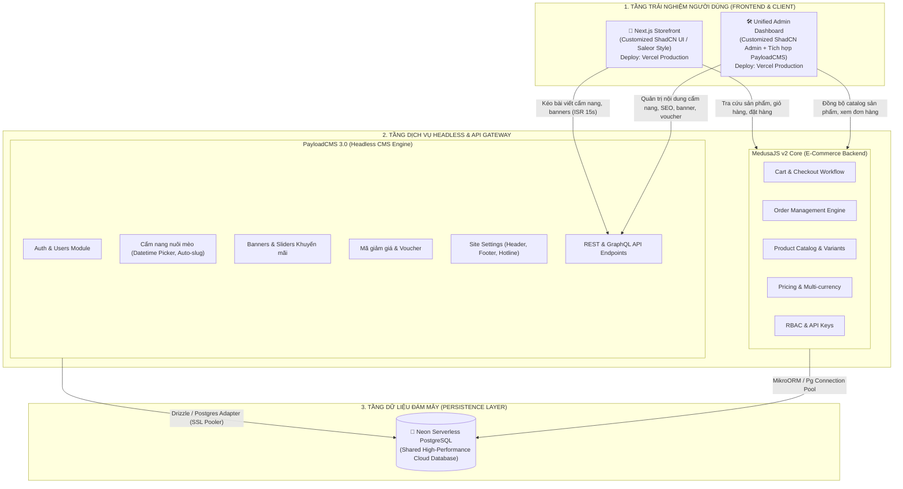
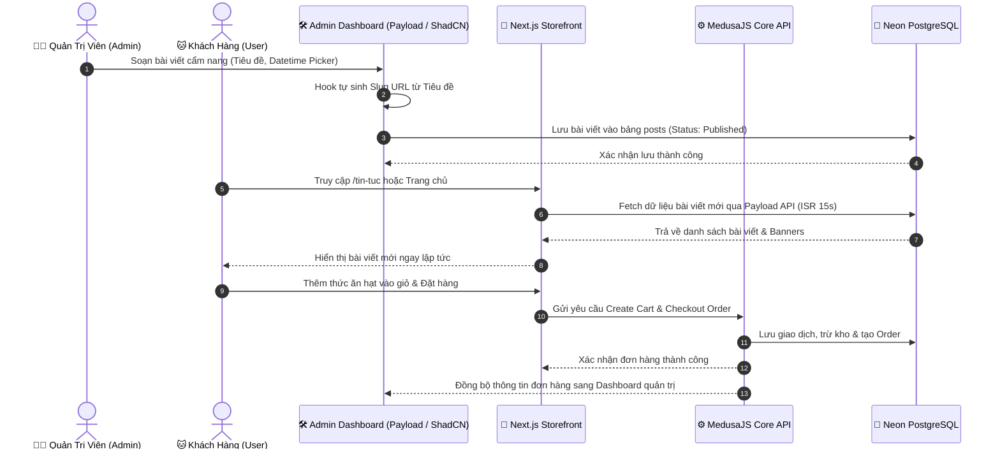

# KIẾN TRÚC HỆ THỐNG HEADLESS E-COMMERCE (MÈO CƯNG PET SHOP)

> **Dự án:** Hệ thống Thương Mại Điện Tử & Quản Trị Cẩm Nang Chăm Sóc Mèo Cưng  
> **Kiến trúc:** Headless / Decoupled Microservices Architecture  
> **Ngăn xếp công nghệ:** Next.js (Storefront) + PayloadCMS 3.0 (Headless CMS) + MedusaJS v2 (E-commerce Core Engine) + Neon PostgreSQL Cloud.

---

## 1. Sơ đồ Kiến trúc Tổng thể (High-Level Architecture)

---

## 2. Chi tiết các Phân hệ Kiến trúc

### A. Storefront Next.js (Customized ShadCN / Saleor Style)
- **Công nghệ:** Next.js 15 (App Router), Tailwind CSS, Lucide Icons, ShadCN UI Components.
- **Phong cách thiết kế:** Tối giản, hiện đại theo chuẩn Saleor Storefront, gam màu cam ấm chủ đạo của thương hiệu Mèo Cưng.
- **Nhiệm vụ:**
  - **Trang chủ (`/`):** Hero Banner khuyến mãi (kéo từ PayloadCMS), danh mục sản phẩm nổi bật, bài viết cẩm nang mới nhất.
  - **Danh mục & Chi tiết sản phẩm (`/products`, `/products/[id]`):** Tích hợp giỏ hàng và danh mục hạt, pate, cát vệ sinh.
  - **Trang Cẩm Nang Tin Tức (`/tin-tuc`, `/posts/[slug]`):** Tích hợp cơ chế **ISR (Incremental Static Regeneration)** cập nhật sau mỗi 15 giây khi có bài viết mới từ PayloadCMS.
  - **Nút điều hướng quản trị (`Header`):** Dẫn thẳng vào Unified Admin có kiểm tra quyền đăng nhập.

---

### B. Admin Dashboard (Customized theo ShadCN + Tích hợp PayloadCMS)
- **Kiến trúc tích hợp:** Tận dụng thế mạnh của **PayloadCMS 3.0** (chạy native trên Next.js App Router) kết hợp thiết kế Dark Mode tối giản theo phong cách **ShadCN UI**.
- **Tính năng quản trị tập trung:**
  1. **Quản lý Tài khoản (Users):** Phân quyền Super Admin, Editor, Customer với chuẩn mã hóa PBKDF2 bảo mật.
  2. **Cẩm nang nuôi mèo (`posts`):**
     - Quản lý hơn 100 bài viết cẩm nang chuẩn SEO.
     - Bộ chọn ngày giờ xuất bản (**Datetime Picker**) chính xác.
     - Tự động sinh đường dẫn tĩnh (**Auto Slug hook**) thân thiện từ tiêu đề bài viết.
  3. **Quản lý Bán hàng:**
     - Danh mục **Sản phẩm hạt & pate (`products`)**.
     - Danh mục **Đơn hàng (`orders`)**: Theo dõi trạng thái *Chờ xác nhận, Đang giao, Hoàn thành*.
     - Danh mục **Voucher & Khuyến mãi (`coupons`)**: Quản lý mã giảm giá, hạn sử dụng.
     - Danh mục **Đánh giá (`reviews`)**: Kiểm duyệt số sao và phản hồi của khách hàng.
  4. **Cấu hình toàn trang (Globals Site Settings):** Cài đặt Hotline, Tên shop, Địa chỉ hiển thị thống nhất trên toàn hệ thống.

---

### C. MedusaJS v2 API (Core E-Commerce Engine)
- **Công nghệ:** MedusaJS v2 Framework (Node.js 20).
- **Môi trường triển khai:** Render Web Service (Containerized Node.js 24/7 daemon).
- **Trách nhiệm hệ thống:**
  - Xử lý nghiệp vụ lõi về thương mại điện tử (Core Workflows).
  - Quản lý phiên giỏ hàng (Cart Session), định giá (Price Sets), địa chỉ giao hàng và quy trình đặt hàng.
  - Cung cấp Store API và Admin API được bảo vệ qua JWT và API Key.

---

### D. Cơ sở dữ liệu Neon PostgreSQL Cloud
- **Cơ chế:** Database đám mây phi máy chủ (Serverless PostgreSQL) hỗ trợ tự động co giãn và kết nối an toàn SSL.
- **Chia sẻ dữ liệu:**
  - Lưu trữ các bảng CMS của Payload: `users`, `posts`, `products`, `banners`, `coupons`, `orders`, `reviews`, `site_settings`...
  - Lưu trữ lược đồ E-commerce của Medusa: `cart`, `order`, `product_variant`, `payment`...

---

## 3. Luồng dữ liệu hoạt động (Data Flow Sequence)

---

## 4. Bảng phân phối Hạ tầng & Deployment

| Thành phần | Công nghệ | Nền tảng Cloud | Địa chỉ Deployment |
| :--- | :--- | :--- | :--- |
| **Storefront** | Next.js 15, Tailwind, ShadCN | **Vercel** | `https://meocung-ecommerce-seven.vercel.app` |
| **Admin Dashboard & CMS** | PayloadCMS 3.0, ShadCN Dark Theme | **Vercel** | `https://meocung-payload.vercel.app/admin` |
| **E-Commerce API Core** | MedusaJS v2 Framework | **Render** | `https://meocung-medusa.onrender.com` |
| **Cơ sở dữ liệu tập trung**| PostgreSQL Serverless (Pooler) | **Neon Cloud** | `ep-hidden-morning-bigw8w9g...neon.tech` |
