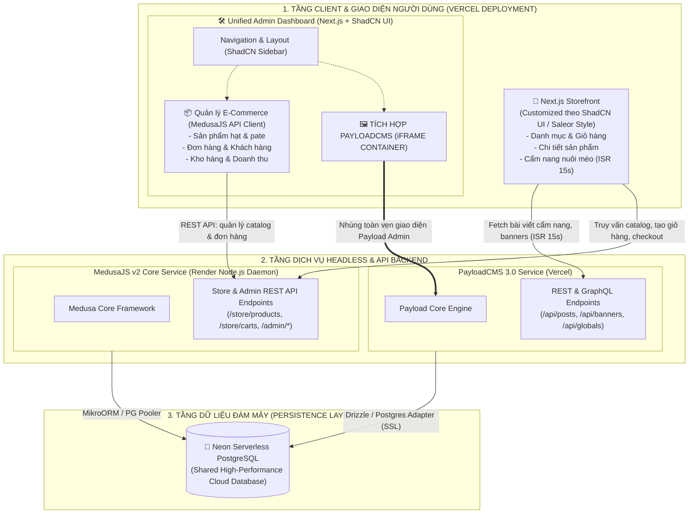
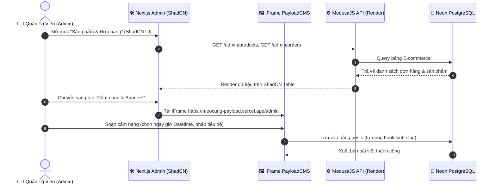

# KIẾN TRÚC HỆ THỐNG HEADLESS E-COMMERCE (MÈO CƯNG PET SHOP)

> **Dự án:** Hệ thống Thương Mại Điện Tử & Quản Trị Cẩm Nang Chăm Sóc Mèo Cưng  
> **Kiến trúc:** Headless / Decoupled Microservices Architecture  
> **Giải pháp tích hợp:** Unified Next.js Admin Dashboard (ShadCN UI) nhúng PayloadCMS qua **iFrame** & kết nối MedusaJS Core API.

---

## 1. Sơ đồ Kiến trúc Hệ thống Tổng thể (System Architecture)



---

## 2. Chi tiết Từng Thành phần Theo Định Hướng Của Mentor

### 1. Storefront Next.js (Customized ShadCN / Saleor Style)
- **Công nghệ:** Next.js 15 (App Router), Tailwind CSS, Lucide Icons, ShadCN UI.
- **Phong cách:** Lấy cảm hứng từ Saleor Storefront hiện đại, gam màu cam ấm của shop Mèo Cưng.
- **Tính năng:**
  - Trang chủ giới thiệu sản phẩm hạt, pate, cát vệ sinh và bài viết nổi bật.
  - Trang `/tin-tuc` và `/posts/[slug]` đồng bộ tự động với PayloadCMS qua ISR (Incremental Static Regeneration sau 15 giây).
  - Tích hợp giỏ hàng và đặt hàng kết nối trực tiếp Medusa Core API.

---

### 2. Unified Admin Dashboard (Next.js + ShadCN UI)
- **Công nghệ:** Next.js (Deploy lên Vercel), giao diện xây dựng hoàn toàn bằng **ShadCN UI** (Sidebar, Table, Dialog, Badge, Tabs...).
- **Cơ chế tích hợp iFrame (Theo định hướng Mentor):**
  - Tạo một tab/menu riêng mang tên **"Quản trị Nội dung (PayloadCMS)"**.
  - Nhúng trực tiếp giao diện quản trị đầy đủ của Payload qua thẻ:
    ```tsx
    <iframe 
      src="https://meocung-payload.vercel.app/admin" 
      className="w-full h-[calc(100vh-64px)] border-0 rounded-xl"
      title="PayloadCMS Admin"
    />
    ```
  - **Lợi ích kiến trúc:**
    - Không làm phình to gói bundle của Admin Dashboard.
    - Giữ nguyên 100% sức mạnh gốc của PayloadCMS (Rich Text Lexical, Datetime Picker, Auto Slug, Banners, Media).
    - Quản trị viên chỉ cần mở **1 trang Dashboard duy nhất** để vừa xem doanh thu/sản phẩm Medusa, vừa chuyển tab soạn thảo bài viết cẩm nang PayloadCMS.

---

### 3. PayloadCMS 3.0 (Headless CMS Engine)
- **Môi trường:** Deploy độc lập trên Vercel.
- **Chức năng:**
  - Chuyên trách quản lý bài viết cẩm nang chăm sóc mèo (100+ bài mẫu).
  - Tự động sinh đường dẫn tĩnh (`slug`) từ tiêu đề.
  - Quản lý Banner khuyến mãi, Mã giảm giá (Coupons) và Cấu hình toàn trang (Site Settings).
  - Expose REST API chuẩn cho Storefront và Admin Dashboard tiêu thụ.

---

### 4. MedusaJS v2 Core (E-Commerce Backend)
- **Công nghệ:** MedusaJS v2 Framework (Node.js 20).
- **Môi trường:** Render Web Service (Chạy dạng Headless Core API daemon).
- **Chức năng:**
  - Trái tim thương mại điện tử: Xử lý quy trình giỏ hàng (Cart), Đơn hàng (Order), Khách hàng (Customer), Quản lý giá (Price Sets) và Phân quyền API.

---

### 5. Cơ sở dữ liệu Neon Serverless PostgreSQL
- Cơ sở dữ liệu đám mây PostgreSQL tập trung, kết nối qua SSL Pooler tốc độ cao.
- Phân tách rõ ràng giữa các bảng nghiệp vụ bán hàng của Medusa và các bảng nội dung của PayloadCMS.

---

## 3. Sơ đồ Tương tác Dữ liệu & Nhúng iFrame



---

## 4. Bảng Tổng Hợp Triển Khai Hạ Tầng

| Thành phần | Công nghệ triển khai | Nền tảng Cloud | Địa chỉ URL |
| :--- | :--- | :--- | :--- |
| **Storefront** | Next.js 15, ShadCN, Saleor Style | **Vercel** | `https://meocung-ecommerce-seven.vercel.app` |
| **Admin Dashboard** | Next.js, ShadCN UI (Tích hợp iFrame) | **Vercel** | `https://meocung-ecommerce-seven.vercel.app/admin` |
| **PayloadCMS Engine**| PayloadCMS 3.0, PostgreSQL Adapter | **Vercel** | `https://meocung-payload.vercel.app/admin` |
| **Medusa E-Commerce** | MedusaJS v2 Core API | **Render** | `https://meocung-medusa.onrender.com` |
| **Cơ sở dữ liệu** | Serverless PostgreSQL | **Neon Cloud**| `ep-hidden-morning-bigw8w9g...neon.tech` |
