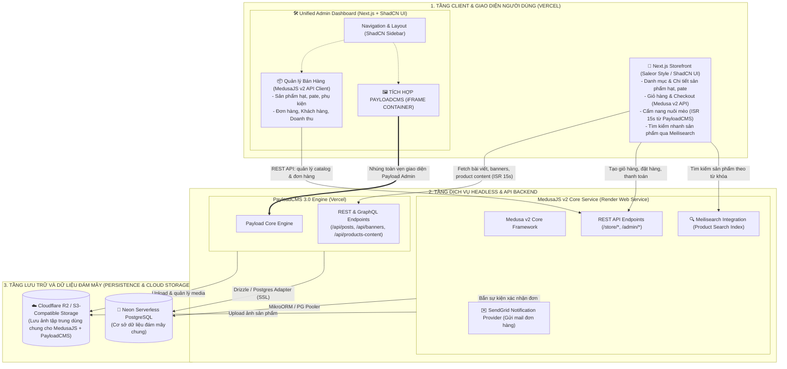
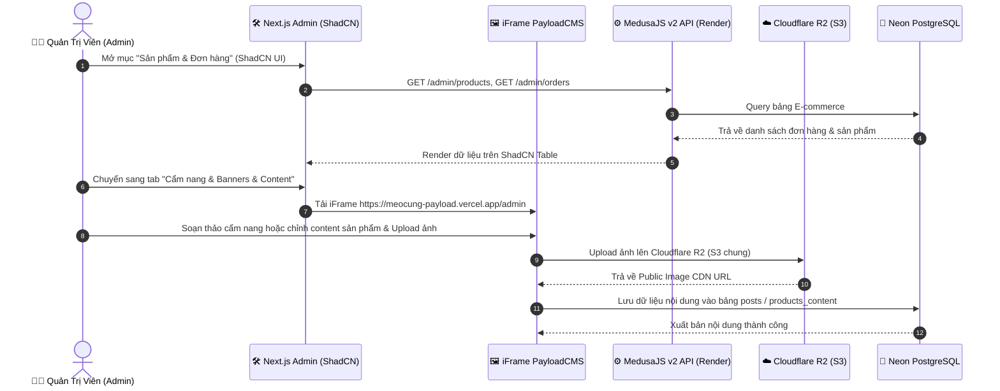

# KIẾN TRÚC HỆ THỐNG HEADLESS E-COMMERCE (MÈO CƯNG PET SHOP)

> **Dự án:** Hệ thống Thương Mại Điện Tử & Quản Trị Nội Dung Cửa Hàng Mèo Cưng  
> **Kiến trúc:** Headless / Decoupled Microservices Architecture (MedusaJS v2 Core)  
> **Giải pháp tích hợp:** Unified Next.js Admin Dashboard (ShadCN UI) nhúng PayloadCMS qua **iFrame** & kết nối MedusaJS v2 Core API.

---

## 1. Sơ đồ Kiến trúc Hệ thống Toàn diện (System Architecture)



---

## 2. Chi tiết Từng Thành phần Theo Định Hướng Của Mentor

### 1. Storefront Next.js (Customized ShadCN / Saleor Style)
- **Công nghệ:** Next.js 15 (App Router), Tailwind CSS, Lucide Icons, ShadCN UI.
- **Phong cách:** Lấy cảm hứng từ Saleor Storefront hiện đại, gam màu cam ấm của shop Mèo Cưng.
- **Tính năng:**
  - Trang chủ giới thiệu sản phẩm hạt, pate, cát vệ sinh và bài viết nổi bật.
  - Trang `/tin-tuc` và `/posts/[slug]` đồng bộ tự động với PayloadCMS qua ISR (Incremental Static Regeneration sau 15 giây).
  - Tích hợp giỏ hàng và đặt hàng kết nối trực tiếp Medusa v2 Core API.
  - Tìm kiếm sản phẩm thông minh qua **Meilisearch**.

---

### 2. Unified Admin Dashboard (Next.js + ShadCN UI)
- **Công nghệ:** Next.js (Deploy lên Vercel), giao diện xây dựng hoàn toàn bằng **ShadCN UI** (Sidebar, Table, Dialog, Badge, Tabs...).
- **Cơ chế tích hợp iFrame (Theo định hướng Mentor):**
  - Tạo một tab/menu riêng mang tên **"Quản trị Nội dung (PayloadCMS)"**.
  - Nhúng trực tiếp giao diện quản trị đầy đủ của Payload qua thẻ:
    ```tsx
    <iframe 
      src="https://meocung-payload.vercel.app/admin" 
      className="w-full h-[calc(100vh-64px)] border-0 rounded-xl"
      title="PayloadCMS Admin"
    />
    ```
  - **Lợi ích kiến trúc:**
    - Không làm phình to gói bundle của Admin Dashboard.
    - Giữ nguyên 100% sức mạnh gốc của PayloadCMS (Rich Text Lexical, Datetime Picker, Auto Slug, Banners, Media).
    - Quản trị viên chỉ cần mở **1 trang Dashboard duy nhất** để vừa xem doanh thu/sản phẩm Medusa, vừa chuyển tab soạn thảo bài viết cẩm nang và quản lý content của sản phẩm trên PayloadCMS.

---

### 3. Tích hợp PayloadCMS chỉnh Content của Product (Medusa v2 Integration)
- **Mục đích:** Sử dụng PayloadCMS làm trung tâm quản lý nội dung đa phương tiện, bài viết cẩm nang và nội dung chi tiết dạng Rich Text (Lexical) cho sản phẩm của Medusa.
- **Cơ chế kết nối:**
  - Sản phẩm cơ sở (tên, giá, SKU, biến thể, tồn kho) được lưu và xử lý bởi MedusaJS v2.
  - Nội dung mô tả chuyên sâu, thông tin dinh dưỡng, hướng dẫn sử dụng sản phẩm được quản lý trên PayloadCMS và liên kết bằng `medusa_product_id` (hoặc `handle`).
  - Storefront Next.js kết hợp (compose) dữ liệu từ cả 2 API trước khi render cho khách hàng xem.

---

### 4. Lưu trữ Media tập trung: Cloudflare R2 (S3-Compatible)
- **Định hướng của Mentor:** `Cloudflare R2 => S3 để lưu ảnh. MedusaJS + PayloadCMS => dùng chung S3`.
- **Cơ chế triển khai:**
  - Sử dụng Cloudflare R2 bucket với giao thức S3-compatible (tiết kiệm chi phí egress, băng thông miễn phí).
  - Cả **MedusaJS v2 (S3 File Plugin)** và **PayloadCMS 3.0 (@payloadcms/plugin-cloud-storage / S3 Adapter)** đều cùng kết nối vào một Bucket R2 duy nhất.
  - Đảm bảo tính nhất quán của đường dẫn ảnh sản phẩm và media bài viết trên toàn hệ sinh thái.

---

### 5. Tìm kiếm & Thông báo (Search & Email)
- **Tìm kiếm Meilisearch:** Cung cấp khả năng tìm kiếm sản phẩm tức thì (Instant Search), sửa lỗi chính tả và lọc theo danh mục cho khách hàng trên Storefront.
- **Gửi mail SendGrid:** Tích hợp Notification Provider vào Medusa v2 để tự động gửi email xác nhận đặt hàng, cập nhật trạng thái đơn cho khách hàng.

---

### 6. Khả năng mở rộng (Marketplace / Multi-vendor)
- Theo định hướng nghiên cứu từ Mentor về mô hình Marketplace (Techlabi Medusa Marketplace Plugin / B2B):
- Kiến trúc MedusaJS v2 cho phép mở rộng thêm module **Multi-Vendor / B2B** khi dự án phát triển sang giai đoạn cho phép nhiều shop thú cưng cùng tham gia bán hàng.

---

## 3. Sơ đồ Tương tác Dữ liệu & Nhúng iFrame



---

## 4. Bảng Tổng Hợp Triển Khai Hạ Tầng

| Thành phần | Công nghệ triển khai | Nền tảng Cloud | Địa chỉ URL / Dịch vụ |
| :--- | :--- | :--- | :--- |
| **Storefront** | Next.js 15, ShadCN, Saleor Style | **Vercel** | `https://meocung-ecommerce-seven.vercel.app` |
| **Admin Dashboard** | Next.js, ShadCN UI (Tích hợp iFrame) | **Vercel** | `https://meocung-ecommerce-seven.vercel.app/admin` |
| **PayloadCMS Engine**| PayloadCMS 3.0, PostgreSQL Adapter | **Vercel** | `https://meocung-payload.vercel.app/admin` |
| **Medusa E-Commerce** | MedusaJS v2 Core API | **Render** | `https://meocung-medusa.onrender.com` |
| **Cơ sở dữ liệu** | Serverless PostgreSQL | **Neon Cloud**| `ep-hidden-morning-bigw8w9g...neon.tech` |
| **Lưu trữ ảnh (Media)**| S3-Compatible Storage | **Cloudflare R2**| Dùng chung cho Medusa & Payload |
| **Tìm kiếm (Search)** | Full-text & Instant Search Engine | **Meilisearch Cloud** | Index sản phẩm Medusa |
| **Email thông báo** | Transactional Email Service | **SendGrid** | Gửi email hóa đơn & đơn hàng |
